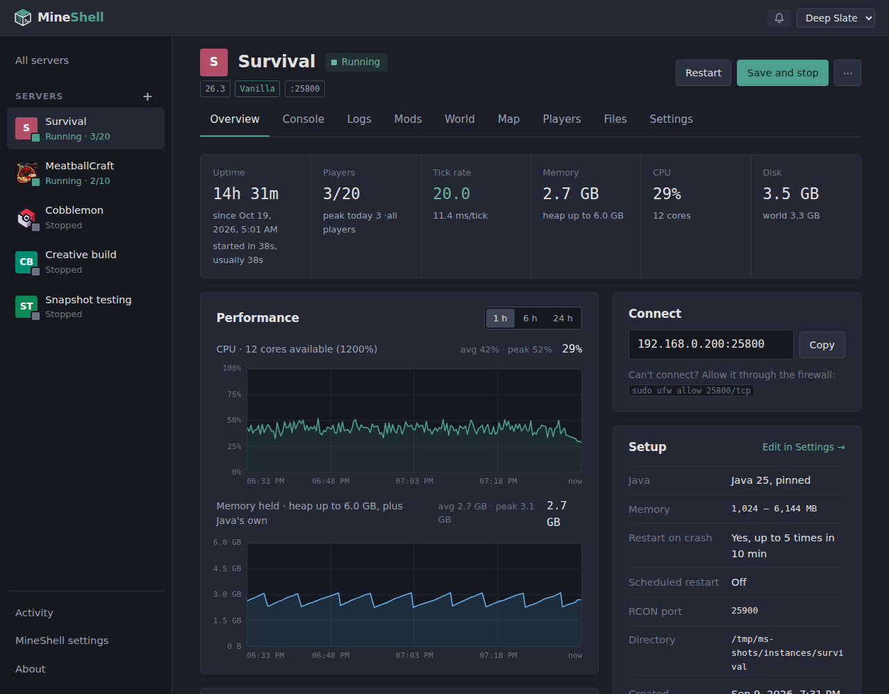
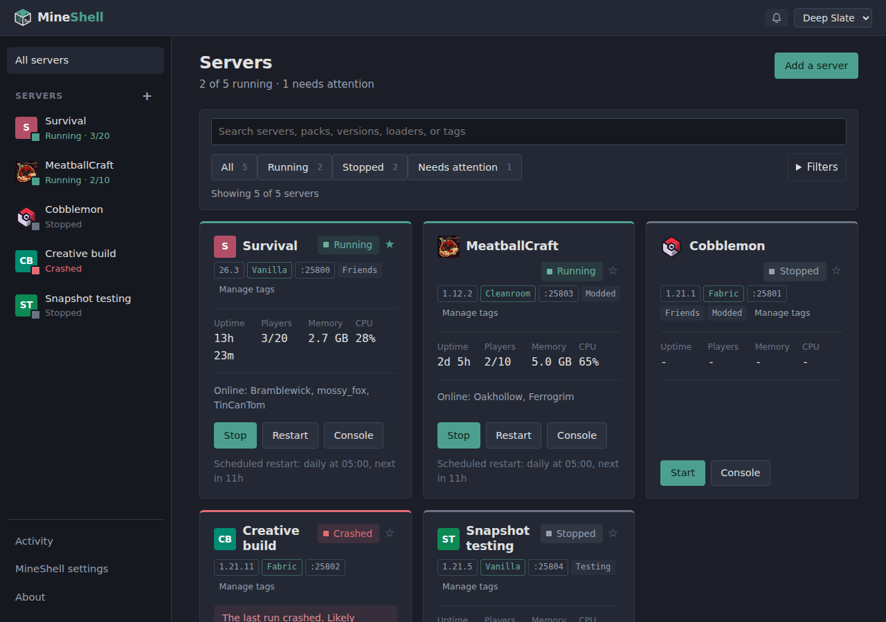
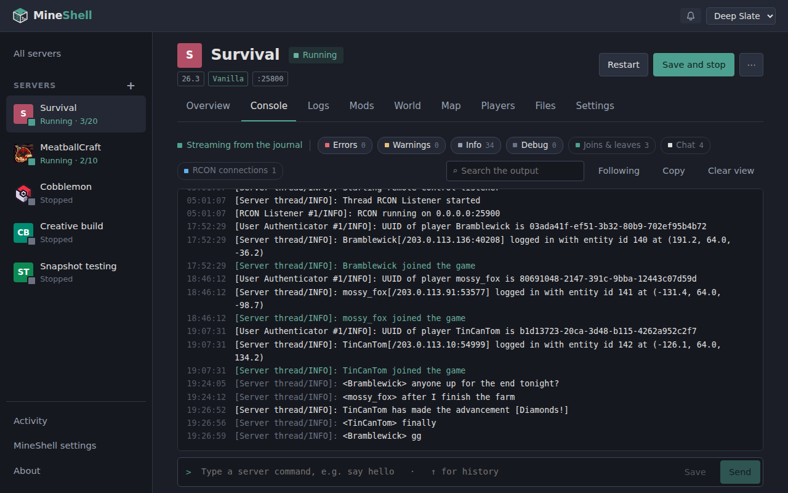
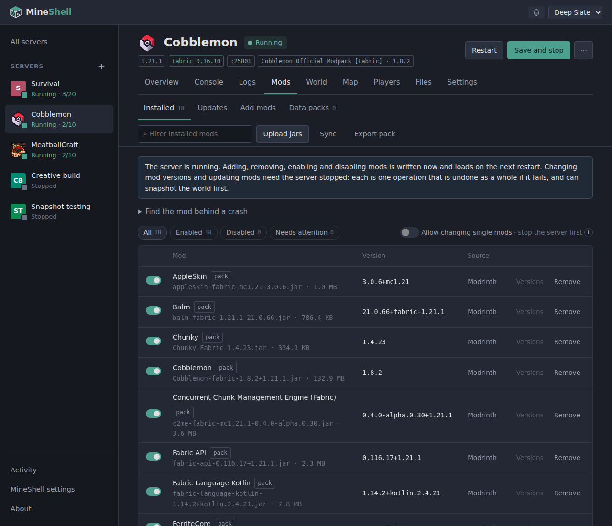
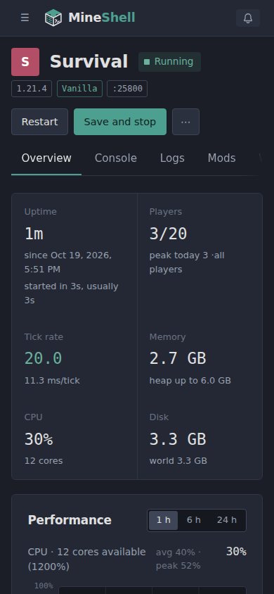

# MineShell

**A self-hosted web control panel for modded Minecraft servers on Linux.**

MineShell brings modpack installation, server management, diagnostics, world administration, and player data editing into one web interface. It runs each Minecraft server as a systemd service, with per-server configuration, resource limits, snapshots, and automation.

Manage your own servers from a browser, or give friends access to specific servers and features through granular account permissions.



<table>
<tr>
<td></td>
<td></td>
</tr>
<tr>
<td></td>
<td align="center"></td>
</tr>
</table>

## Features

### Modpack & instance management

Install and maintain modded Minecraft servers without having to manage every step manually.

- **Multiple sources:** Browse Modrinth, CurseForge, and FTB, upload `.mrpack` or CurseForge archives, or create a server from a Minecraft version and loader.
- **Loader support:** Vanilla, Fabric, Quilt, Forge, NeoForge, and Cleanroom.
- **Pack updates:** Update to a different pack version, including packs originally installed from uploaded files. Configuration changes are preserved or merged, with side-by-side review when both you and the pack changed the same lines. The preview lists files you added to the pack's folders and lets you keep yours where the new version ships its own.
- **Update notices:** Each server is checked for a newer pack version (pack servers) or loader build and mod updates (servers set up from a loader) on a schedule you pick, with betas and alphas optional. The overview shows what is out, with a button to review and install it or to skip that version.
- **Rollback:** Revert the last pack change, restoring the previous configuration and optionally the world from its pre-update snapshot.
- **Minecraft and loader migrations:** Move eligible non-pack servers between Minecraft versions or loaders. Compatible mod builds are selected where available; unsupported mods are disabled and listed.
- **Forge 1.12.2 / Cleanroom migration:** Switch between Forge and Cleanroom, including handling the compatible Fugue version required by Cleanroom.
- **Safe experimentation:** Copy an entire server to test changes separately.
- **Move between machines:** Export a server to one file and import it into another MineShell, with its world, configs, settings and mod records. Mods from Modrinth and CurseForge are downloaded again on import instead of being packed, and the loader is installed again, so exports stay small.
- **Installation recovery:** Failed downloads are reported with manual download links and retry options. Long-running operations report progress and recover interrupted changes after a MineShell restart.
- **Server icons:** Pack icons are used automatically and can be replaced in server settings.

### Server operations & monitoring

Control server lifecycles and monitor what is happening without leaving the browser.

- Start, stop, restart, and force-stop servers, including delayed shutdowns with in-game warnings.
- Perform graceful shutdowns using RCON to save the world before stopping Java, with signal-based fallbacks.
- Configure crash recovery, restart attempt limits, scheduled restarts (daily, or every few hours on the clock: every 6 hours is 0:00, 6:00, 12:00, 18:00), and scheduled console commands (on the clock too, or daily at a time).
- Delay scheduled operations while players are online.
- Let Minecraft 1.21.2+ pause an empty server (its `pause-when-empty-seconds`, in settings and new-server defaults); the status shows it paused until someone joins.
- See every server's ports (game, RCON, query, voice chat, map) and what listens on each, with clashes between servers and ports other programs hold, and move one to a free port. Where new ports start can be changed for setups that need it.
- Set per-server CPU and memory limits, and a cap on all servers together (a soft memory cap that slows the servers down instead of killing one), and detect servers that never finish starting.
- Get notified on Discord, on your phone (ntfy) or through a webhook when a server crashes, is killed for its memory, gets stuck starting, fails to copy its snapshots to the backup folder or has an update, and optionally on restarts, starts, stops and players joining or leaving. A server can send to its own channel instead or as well.
- Get a warning before starting a server the machine may not have the memory for, counting what the running servers can still grow into.
- Choose which servers start after a machine reboot: restore their previous state, always start, or never start automatically.
- Monitor uptime, startup duration, online players, player session times, daily player peaks, CPU and memory usage, disk consumption, and tick rate where available.
- Inspect Java heap usage and receive guidance when memory allocation seems insufficient or excessive.
- View server addresses and manage players directly from the overview.
- See on the Activity page how the outside services MineShell uses (Modrinth, the modpacks.ch mirror, Mojang, Java and loader sites) answered since it started, with a warning while one is not answering.

### Console, logs & crash diagnostics

Find out what went wrong without manually digging through files and terminal output.

- Live console output streamed from the systemd journal, with commands sent through RCON.
- Filter log levels, search output, expand or collapse stack traces, and highlight player joins and departures.
- Command history, saved commands, and a dedicated chat view.
- Search previous server runs, server logs, and crash reports together, including archived logs.
- Analyze logs with mclo.gs for a second opinion, or share them through a link that MineShell can subsequently delete.
- Diagnose crashes and identify likely problematic mods, with one-click mod disabling where supported. Old crashes can be cleared from the overview once the server starts cleanly again, and clear on their own when a one-click fix worked. A server the kernel killed for its memory (its limit, or the machine running out) is named as such.
- Detect crashes where the Java process remains alive but the server has stopped functioning.
- Run timed Spark profiles and view uploaded results. If Spark's upload fails, download the saved profile or upload it again.
- **Mod bisect assistant:** When ordinary diagnosis cannot identify the cause, systematically test individual mods or pairs of mods using a throwaway world, then restore the original server configuration.

### Mod management & client exports

Manage server mods and prepare matching client installations from the same interface.

- Search Modrinth and CurseForge, resolve mod dependencies, install updates, or upload JARs manually.
- Enable, disable, delete, and change mod versions.
- Detect mods added outside MineShell and identify them rather than silently ignoring them.
- Spot the same mod installed twice (for example once from Modrinth and once from CurseForge under another file name) by the mod ids inside the jars, and disable one copy.
- Detect and disable client-only mods after pack installation.
- Browse and install data pack releases directly into a world's `datapacks/` directory, and update them (a world-generation pack the world uses only with the server stopped, after a snapshot).
- Export client installations as Modrinth `.mrpack` files, CurseForge ZIP archives, or Prism Launcher instances.
- Put the server in the exported pack's multiplayer list, so players join without typing the address.
- Choose which mods and folders to include in an export. For servers installed from modpacks, include the original pack's client-side files that were not needed on the server.

### World management & snapshots

Manage worlds, recover from mistakes, and automate routine maintenance.

- Create snapshots manually, on a schedule, or automatically before risky operations.
- Snapshot a running server with saving paused, or stop and restart it around the operation.
- Configure retention by snapshot count and storage usage. Pin, name, tag, and filter snapshots.
- Restore a snapshot, reset a world, replace it with an uploaded world, or download a world as a ZIP archive.
- Keep several worlds per server: start a new one without deleting the old, upload one, switch between them, and turn any snapshot into a world of its own. Each world keeps its seed, data packs and map.
- Reset or restore individual dimensions.
- Restore chosen chunks from a snapshot, picked on a map of the dimension drawn from the world's own files (top blocks with their textures' colours, modded blocks too).
- Prune chunks that have not actually been visited, previewed on a heatmap of where players spent time, with chunks to keep picked on the map.
- Pre-generate terrain with Chunky and monitor its progress: plan the area on a map of the world (square, rectangle, circle or ellipse, centered on spawn, the world border or any point), which shows how many chunks are new and about how much disk they take; it can pause while players are online and continue by itself after a restart.
- Coordinate snapshots and scheduled restarts so they do not interfere with each other.
- Copy snapshots to a backup folder on another disk, a mounted network share or a USB drive, right after each one is taken, with its own retention, compressed (about a third smaller) or as plain folders. Copy one back to restore it, also into a server made again after the old one was lost. A missing or full folder is reported (and notified), never created on the system disk underneath.

**Backup limitation:** Backup folders are folders on this machine; cloud and remote destinations (S3, SFTP, rclone) are not implemented yet.

### Player management & inventory editing

Administer players and inspect their saved data, including inventories containing modded items.

- Manage whitelists, operators and operator levels, bans with reasons, and IP bans.
- Remove a player from a world (their player file, stats and advancements go to the trash), for someone who joined once and should not stay in the list.
- Update player lists through RCON while the server is running, or edit the relevant JSON files while it is stopped.
- Resolve player names to UUIDs through Mojang and identify players in imported worlds using their current account names.
- Inspect offline player inventories, effects, and other saved data.
- See each player's statistics (time played, deaths, kills, distance, blocks mined and every item, block and mob the game counts) with readable times and distances, and rank players by any of them.
- Edit modded inventories, including backpacks and Curios or Trinkets equipment slots, with slots grouped and named where supported.
- Select enchantments by name from the world's own enchantment table, including modded enchantments on Minecraft 1.12 and older.
- Browse vanilla and modded items by name instead of having to type their identifiers.
- View item icons and 3D block models sourced from Minecraft and installed mod JARs.
- Render supported special models, including chests, shulker boxes, beds, banners, heads, shields, conduits, decorated pots, and additional model-based variants.
- Inspect item tooltips containing information such as enchantments, durability, energy, and item identifiers.

Item rendering can be disabled in MineShell settings, leaving names and data available without loading or drawing item models.

### World maps

Explore your worlds through an integrated browser-based map.

- **Minecraft 1.13 and newer:** BlueMap renders a 3D map directly from world files, including modded blocks using models from the installed mods.
- Update the map manually or on a schedule.
- View the map without adding a rendering mod to the Minecraft server. Add the BlueMap mod when a live map with player positions is desired.
- **Forge 1.12.2:** Install Dynmap and DynmapBlockScan through the Map tab for a live map.

### Networking & public access

Let players join from outside your local network without manually configuring port forwarding.

- Integrate a playit.gg account through an approval flow; MineShell does not receive your playit.gg password.
- Enable public access for individual servers.
- Automatically manage the tunnel agent and server tunnel, keeping the tunnel associated with the server's port.
- Display the public address in the server interface and remove the tunnel when the server is deleted.
- Access the agent's playit.gg page and choose its connection location where supported by the account plan.

### Settings, files & Java

Manage server configuration and files without needing direct shell access for routine tasks.

- Searchable, tabbed settings for general options, gameplay, players, networking, performance, Java and memory, automation, snapshots, and advanced configuration.
- Typed controls for common `server.properties` options, alongside an editor for additional keys and a raw configuration editor. Unrecognized properties are preserved.
- Port availability checks, with options to swap ports with another server or move to a free port.
- Browse, upload, download, rename, delete, and edit text files within an instance directory.
- Upload files and folders by dragging them into the file browser.
- Recover deleted files from a per-server trash, with configurable automatic cleanup.
- Open server directories in a file manager through SFTP links.
- Inspect disk usage, including world-map data stored outside the server directory.
- Discover installed Java runtimes or download Eclipse Temurin and Azul Zulu builds.
- Match Java versions to individual servers using Minecraft's version metadata, with configurable defaults when multiple runtimes are available.

### Multi-user access & permissions

Share MineShell with friends while controlling which servers and features each account can access.

- **Global administrators:** The owner and MineShell administrators can manage the entire application.
- **Per-server access:** Grant full administrative access to a server or assign individual permissions for operations such as starting and stopping, console access, mods, settings, files, and snapshots.
- **Player-data restrictions:** Limit access to all players or specific players.
- **Automatic ownership:** The account that creates or copies a server becomes its administrator. Access to copied servers is not automatically granted to everyone who could access the original.
- **Account management:** Create accounts, issue one-time passwords, require password replacement on first login, disable accounts, and sign them out everywhere.
- **Permission-aware interface:** Accounts see only their permitted servers, tabs, and controls. Settings that are readable but not editable are marked accordingly.
- **Activity log:** Review recent actions and the account responsible for each one.
- **Protected integrations:** Only the owner can manage the playit.gg and CurseForge connections or update MineShell.

### MineShell updates

Keep MineShell itself up to date without manually replacing the installation.

- Check for new releases every 12 hours or on demand.
- View release notes and install updates from the web interface.
- Browse every release with its notes, and go back to an older one when a release brings a problem (with warnings, a database backup first, and a refusal where the older version could not work with the database).
- Apply updates in place and restart MineShell while Minecraft servers continue running.

## Requirements

- Linux with systemd.
- Node.js 22.12 or newer.
- `journalctl`, provided by systemd.
- A compatible Java runtime for each Minecraft version. MineShell can discover or download supported runtimes.

MineShell is intended for self-hosted use on a Linux machine. It is not a multi-tenant hosting panel: Minecraft servers run under the same Linux account as MineShell. Users granted access to files, mods, or Java and loader settings may be able to execute programs as that account. Only grant those permissions to people you trust.

## Installation

Run the installer as the Linux account that should own and run the Minecraft servers, **not as root**.

```sh
curl -fsSL https://github.com/Manyullyn17/MineShell-Reloaded/releases/latest/download/install.sh | bash
```

The installer installs MineShell into `~/mineshell`, writes configuration to `~/.config/mineshell/mineshell.env` without overwriting an existing settings file, and sets up a systemd user service that starts at boot. The default port is `3000`. Running the installer again updates an existing installation.

Open MineShell in your browser and set the owner account's password on first visit. The initial account name is `admin`.

For installation options, directory layout, and uninstall instructions, see [Deployment](docs/DEPLOYMENT.md).

## Development

Clone the repository and install dependencies:

```sh
npm ci
cp .env.example .env
npm run setup
npm run doctor
npm run dev
```

For a production build:

```sh
npm run build
npm start
```

The production server respects `PORT` and `HOST` from `.env`.

If `doctor` reports that lingering is not enabled, run the following so user services can continue running after logout:

```sh
loginctl enable-linger "$USER"
```

Keep development data separate from any production MineShell installation by using a separate `MINESHELL_DATA` and `MINESHELL_UNIT_PREFIX`.

Run the test suite with:

```sh
npm test
```

Tests run offline and do not touch real server data. For watch mode and further details, see [tests/README.md](tests/README.md).

## Configuration

MineShell is configured through environment variables. Installed instances read them from their settings file; development instances use `.env`.

See [`.env.example`](.env.example) for the complete list.

| Variable | Default | Purpose |
| --- | --- | --- |
| `MINESHELL_DATA` | `~/.local/share/mineshell` | Data directory for server instances and application data. |
| `MINESHELL_AUTH` | `on` | Authentication toggle. Disable only on a network you fully trust. |
| `MINESHELL_UNIT_PREFIX` | `minecraft` in development; `mineshell` in the installer | Prefix for systemd instance units. |
| `CURSEFORGE_API_KEY` | Unset | Optional CurseForge API key for improved metadata access. Can also be configured in MineShell. |
| `PORT`, `HOST` | `3000`, `0.0.0.0` | Where the web interface listens. `HOST=127.0.0.1` answers only on this machine (behind a reverse proxy or Tailscale serve). |
| `ADDRESS_HEADER`, `XFF_DEPTH` | Unset, `1` | Behind a reverse proxy: read the client's address from `X-Forwarded-For`, so the login throttle works per client. See [Remote access](docs/DEPLOYMENT.md#remote-access). |
| `BODY_SIZE_LIMIT` | `Infinity` in the example configuration and installer settings | Controls request body size. Production rejects uploads larger than 512 KB when this is unset. |

## Documentation

- [Deployment guide](docs/DEPLOYMENT.md) — installation, configuration, and maintenance.
- [Architecture](docs/ARCHITECTURE.md) — implementation details and design decisions.
- [Roadmap](docs/ROADMAP.md) — planned work and deferred features.
- [Test documentation](tests/README.md) — test setup and behavior.

## Project layout

```text
migrations/          SQL migrations applied at startup
scripts/             Setup and diagnostic tools
src/lib/server/      systemd, RCON, journal, mod providers, scheduling,
                     monitoring, world operations, and other server-side logic
src/lib/shared/      Shared browser/server utilities, formatting, console handling, NBT
src/lib/components/  Shared UI components
src/routes/          Pages and endpoints
tests/               Test helpers, flow tests, fixtures, and recorded crash/log data
docs/                Architecture, deployment, and roadmap documentation
```

## Theming

MineShell's colors are defined using CSS custom properties in `src/app.css`. To add a theme, define a `[data-theme='name']` block and add an entry to `src/lib/shared/themes.ts`. The theme picker updates automatically.

The default theme is Deep Slate.

## Credits

MineShell stands on a lot of other people's work. Thank you to everyone behind these. The same list is on MineShell's About page.

### Libraries

Open source code that ships inside MineShell. Their license texts are in THIRD-PARTY-NOTICES in every release.

- [Svelte and SvelteKit](https://svelte.dev) — The web interface and the server behind it. (MIT)
- [better-sqlite3](https://github.com/WiseLibs/better-sqlite3) — MineShell's database, with SQLite inside it. (MIT)
- [SQLite](https://sqlite.org) — The database engine. (Public domain)
- [Drizzle ORM](https://orm.drizzle.team) — Database queries and schema migrations. (Apache-2.0)
- [marked](https://marked.js.org) — Mod and pack descriptions and release notes, from Markdown. (MIT)
- [DOMPurify](https://github.com/cure53/DOMPurify) — Cleans those descriptions before they are shown. (Apache-2.0 or MPL-2.0)
- [node-tar](https://github.com/isaacs/node-tar) — Unpacks Java downloads. (BlueOak-1.0.0)
- [yauzl and yazl](https://github.com/thejoshwolfe/yauzl) — Reads and writes zip files: packs, world downloads, client exports. (MIT)

### Built with

Tools used to make MineShell, not shipped with it.

- [Vite](https://vite.dev) — Builds MineShell and runs it while developing. (MIT)
- [TypeScript](https://www.typescriptlang.org) — The language most of MineShell is written in. (Apache-2.0)
- [Vitest](https://vitest.dev) — The test suite. (MIT)
- [Drizzle Kit](https://orm.drizzle.team/docs/kit-overview) — Generates the database migrations. (MIT)

### Programs

Downloaded and run by MineShell when a server needs them.

- [Eclipse Temurin](https://adoptium.net) — Java builds MineShell downloads for servers.
- [Azul Zulu](https://www.azul.com/downloads/) — Java builds MineShell downloads for servers.
- [Fabric](https://fabricmc.net) — Mod loader: its installer and server launcher.
- [Quilt](https://quiltmc.org) — Mod loader: its installer.
- [Minecraft Forge](https://minecraftforge.net) — Mod loader: its installer.
- [NeoForge](https://neoforged.net) — Mod loader: its installer.
- [Cleanroom](https://cleanroommc.com) — Mod loader for 1.12.2 packs: its installer, and the client instance for exports.
- [BlueMap](https://bluemap.bluecolored.de) — Renders the Map tab for Minecraft 1.13 and newer.
- [playit.gg agent](https://playit.gg) — Gives servers a public address without opening ports.

### Mods

Installed by MineShell or worked with when a server has them.

- [Dynmap and DynmapBlockScan](https://github.com/webbukkit/dynmap) — The live map for 1.12.2 Forge and Cleanroom servers.
- [BlueMap (mod)](https://modrinth.com/plugin/bluemap) — A live map with players on it, offered beside the rendered one.
- [Fugue](https://modrinth.com/mod/fugue) — Added to every Cleanroom server, so older mods run on it.
- [Scalar Legacy](https://www.curseforge.com/projects/1235372) — Added to every Cleanroom server: the Scala libraries Forge bundled.
- [spark](https://spark.lucko.me) — Profiling from the server's overview, and its viewer.
- [Chunky](https://github.com/pop4959/Chunky) — Pre-generating worlds from the World tab.
- [Simple Voice Chat](https://modrinth.com/plugin/simple-voice-chat) — Its port is kept free and tunnelled with the server.

### Services

Asked by MineShell over the internet.

- [Modrinth](https://modrinth.com) — Mod and pack search, downloads, updates and which mods are client-only.
- [CurseForge](https://www.curseforge.com) — Mods and packs, and the files on its CDN.
- [Feed The Beast (modpacks.ch)](https://feed-the-beast.com) — FTB packs, and CurseForge mods and packs without an API key.
- [Mojang](https://www.minecraft.net) — Game versions, server jars, the Java each version needs, player names and skins.
- [Adoptium and Azul](https://adoptium.net) — Lists of their Java builds.
- [Fabric and Quilt meta](https://meta.fabricmc.net) — Loader versions per Minecraft version.
- [mclo.gs](https://mclo.gs) — Sharing and analysing logs.
- [spark's bytebin](https://spark.lucko.me) — Uploading profiles spark could not upload itself.
- [playit.gg](https://playit.gg) — Tunnels for public access.
- [GitHub](https://github.com) — MineShell updates and BlueMap downloads.

### Thanks

Work MineShell builds on.

- [Aikar's flags](https://mcflags.emc.gs) — The recommended JVM preset.
- [Prism Launcher](https://prismlauncher.org) — The instance format client exports follow.

Not an official Minecraft product. Not approved by or associated with Mojang or Microsoft.

## License

See the repository's [LICENSE](LICENSE) file for licensing information.
